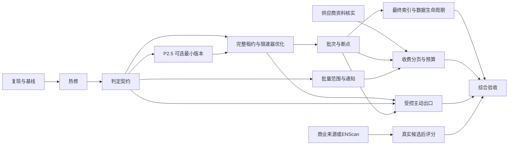

# ScopeDesk 分批实施计划（完整16项审查增量修订）

**最新版状态：39项可追踪工作项；W01–W25保留原编号，W26–W39为本次新增独立工作项。第8–10节为增量修订，若与早期表述冲突，以增量修订为准。**

日期：2026-10-30。技术栈：Go、Vue 3、PostgreSQL 16。用途：实施规划；本文件不代表已编码、已测试或已部署。

## 0. 输入范围与证据等级

A 为此前去重的 14 组待办（12 功能、2 验收）。B 的完整16项正文已补齐。本版保留上一轮W01–W25，并逐项映射全部B16；把此前未覆盖的独立问题增列W26–W39，共39项可追踪工作项。这是可验收任务的粒度，不等于14+16简单相加。第8节给出逐项映射。

已阅读本地交接文档与当前代码；生产最后一次已核实的部署为 2026-10-29，数据库版本 15，本轮未连接生产。旧文档中的“未部署”“版本 9”“E1-b～E1-f 都未完成”是历史状态，不能直接作为当前待办。

证据分三级：①代码可确认的行为；②需要复现或执行计划确认的影响；③尚缺正文/契约的待核实问题。未进行本轮压测，没有吞吐提升倍数结论。

代码确认：results.go:addEvent 将完整 JSON 十六进制编码后拼进 B-tree 主键；WriteResults 单事务遍历资产并更新 last_seen；assets_seen 索引包含 last_seen。queue.go 按字母排序逐主机画像、心跳错误立即取消、scheduler 每 10 秒执行并在末尾调用 ensurePartitions。main.go:login 在 s.mu 内计算口令哈希。pipeline.go:categoryScore 使用 strings.Contains。guard.go:publicIP 手工列出部分特殊前缀；完整审查明确指出NAT64与6to4嵌入地址路径；须在受控网络对具体IPv6样例及实际拨号行为复现。

重要校正：

- crt.sh 当前有意返回“不具备完整性证据”；默认含该来源时，被动缺失判定可能一直不具备执行条件。这不允许通过把所有成功 HTTP 响应当作完整来修复。证书/测绘索引的分页完成，也不自动证明真实资产不存在。
- api_v2.go:assets 是一条列表 SQL 内的两个逐资产关联聚合，并非已经证明存在应用层 N+1 往返；需查看 SubPlan loops、buffers 和请求 SQL 次数。
- “写了很多列”不等于每次都一定不能 HOT；索引引用字段实际变化、页面空间等共同影响。当前 last_seen 持续变化且被索引是明确检查点，最终以统计与 WAL/压测为证。
- NAT64与6to4前缀应按所嵌IPv4和实际连接路径复核；不能仅以匹配大前缀就一律断言可扫描或应封禁。修复的方向是收紧/正确分类，不扩大授权。

## 1. 合并后的工作项清单

编号是本计划的跟踪标识，不是原审查报告的序号。依赖中的“基线”指 P0；“契约”指 P2 的判定语义和事件去重契约。

### W01｜事件去重键有界化（B：dedupe key 过长）

- 目标：事件证据再长也不因索引键尺寸拖垮整个任务；保留事件语义和原始证据。
- 模块：results.go:addEvent、event_dedupes/asset_events、新增迁移、事件测试。
- 依赖：基线、事件等价定义；在 W10 分批提交前完成。
- 方案/风险：版本化键包含资产/事件类型/上海自然日/规范化证据摘要，使用固定长度 SHA-256；保留 detail，不截断证据来缩短键。风险是升级日旧键/新键并存导致重复，或过度归一化把不同事件合并。需选定单写者切换及当日旧数据兼容策略；不原地覆盖历史去重键。
- 验收：长 host、64 KiB 级合法 detail、Unicode、重排后等价证据、不同证据、上海跨日和并发重放均有用例；同一逻辑事件只记一次，不同事件保留，事务不再因超长索引键失败。拒绝超出证据上限的输入时须是明确错误。

### W02｜IPv6 与实际连接地址的安全分类（B：前缀遗漏）

- 目标：补齐可复现的特殊用途地址遗漏，保证解析与实际连接保持同一授权边界。
- 模块：guard.go:publicIP/AllowIP、DNS/CNAME、HTTP 拨号和重定向、IP 规则快照。
- 依赖：基线、审查中的NAT64/6to4及可嵌入私网IPv4的具体遗漏样例；先于W09、W17、W28。
- 风险：简单按大前缀封禁误伤合法地址，IPv4-mapped、嵌入 IPv4、IPv6 字面量、重定向与 DNS rebinding 路径绕过。按权威表逐条核实，考虑更具体前缀例外；转换地址若不能证明安全则拒绝。
- 验收：IPv4/IPv6、映射地址、回环/链路本地/保留用途、重定向后地址变化及双栈回退均测试；被禁止地址在真实 dial 前拒绝，合法公网地址仍须通过项目、范围和黑名单校验。仅“是公网 IP”从不授予扫描权限。

### W03｜口令哈希移出全局锁（B：登录锁）

- 目标：高成本哈希不阻塞全部会话/用户管理操作。
- 模块：main.go:login、口令修改/用户状态、会话和登录尝试计数。
- 依赖：基线；可与 W01、W02 并行设计。
- 风险：解锁后账号停用/口令轮换的 TOCTOU，或并发请求绕过尝试次数。锁内原子预约限流及读取账号版本，锁外计算，签发会话前锁内复核版本/停用状态。不存在用户也保持必要的哈希计算，错误保持一致；不降级口令算法/参数。另设有界的哈希计算并发和等待队列，避免释放全局锁后把阻塞转成不受控的CPU耗尽；占用许可、失败回收和过载响应均要测试。
- 验收：并发失败请求不能越过原限流上限；哈希期间停用/改密不能获得有效新会话；已有会话策略不退化。CPU、mutex/block profile 和登录/其他接口 p95/p99 需实测。

### W04｜被动缺失与实时失败分离（B：默认缺失判定失效）

- 目标：明确默认配置为什么“不具备缺失判定资格”，解决状态和计数混用；不制造虚假 ASSET_DOWN。
- 模块：collectors.go、passive_sources.go、queue.go 的 complete/absence_usable、results.go、资产状态/事件/API/前端。
- 依赖：W01；先于 W10、W16、最终验收。
- 方案/风险：建立 collection_complete、coverage_complete、absence_eligible 独立语义及来源集合/查询版本；新增按来源的被动缺失状态/计数与独立active_failure计数，不再共享一个miss_count；本轮完整成功的来源集合与资产历史来源求交，并对资产曾由哪一来源报告保留审计。旧字段保留含义并提供兼容投影；历史混合计数标未知，不猜测拆分。HTTP 失败、被动缺失和恢复分别记录原因。ASSET_DOWN 若保留被动缺失分支，须明确仅表示“该被动观察集合连续未发现”；不能无依据将 is_alive=false。宁可不判定，也不能把低覆盖索引当事实。
- 验收：默认 crt.sh+CertSpotter 给出可解释的不可判定原因；曾报告该资产的来源本轮完整成功且缺失时，仅相应来源的缺失计数递增；如果历史来源含crt.sh、人工或付费历史索引等不具备完整性证据，则不得用只跑CertSpotter的结果令全资产ASSET_DOWN；连续三轮可信覆盖可进入标注清楚的被动缺失状态；来源切换、限额、部分页、预算耗尽、证据模式、取消和失败不递增；重复 finalizer 不重复计数；第三方旧证据不清空实时失败、不触发恢复。阈值改变和历史重算另行版本化，不悄悄改变旧 API。

### W05｜分类词边界与评分依据（B：categoryScore 子串）

- 目标：减少域名无关子串误报，输出可解释的类别/评分依据。
- 模块：pipeline.go:categoryScore、域名规范化、公用后缀处理、资产分类更新逻辑。
- 依赖：分类契约；与 W04 可并行。
- 风险：替换 contains 后漏掉有意的组合词，自动重算覆盖人工分类。先确定范围根域/可注册域，再仅按子域DNS label和明确的连字符/数字规则匹配；状态变化后按规则版本重算自动分类和评分，人工覆盖优先，不批量回填未经确认的历史数据。
- 验收：api.example 与含 api 子串的普通词、contest 等含 test 的词、IDNA、大小写、连字符、人工覆盖、多个命中优先级均有正反例；评分不宣称归属或漏洞置信度。

### W06｜消除字母序画像饥饿（B：探测顺序偏差）

- 目标：有限时间/预算内，靠后的主机不会长期被跳过。
- 模块：queue.go 候选排序与画像调度、后续 W10 运行代次/游标。
- 依赖：W04 的覆盖语义；持久公平性依赖 W10。
- 风险：简单 random shuffle 不可重放、不保证长期公平，游标跨授权变更错用。先提供可重现的按 run/epoch 排序与未覆盖统计；最终用持久待处理集合+确定性轮转，不只存“最后一个字母序域名”。
- 验收：优先从未画像者，再按dns_at最旧者；固定候选集合、每轮仅容纳子集时，经过规定轮次数后每个仍获授权的候选均获得处理机会；测试能给出明确的等待上界而非概率承诺。预算不足以完成一个任务或持续新增场景要报告未覆盖，不虚称有界完成；撤销候选不能因恢复游标而执行。

### W07｜心跳容错与租约 fencing（B：心跳错误）

- 目标：短暂 DB 故障可恢复，但无法确认租约时禁止继续外发/提交。
- 模块：queue.go:Heartbeat/execute、deadline、worker lease、请求边界及结果写入。
- 依赖：基线；先于 W08/W10 的高并发启用。
- 风险：用“允许连续失败几次”无界延长租约，旧 worker 与新 worker 同时工作。独立短超时心跳、退避重试且不超过上次已确认的租约安全截止；另复现 WriteResults 长持 jobs 行锁与心跳 UPDATE 争用，P3 只能改善短暂故障，长持锁根因须在 P4 消除；不确定期间暂停新请求，续租后再复核授权；确认 lease_lost/取消立即终止。使用 DB 判定和单调时钟剩余时间，不靠客户端墙钟猜测所有权。
- 验收：注入短断连、延迟、连接池耗尽、跨租约中断、worker 接管、用户取消；未确认续租不能新发请求，过期 worker 零提交，重复接管不重复扣本地已确认费用。已发出网络操作不能承诺撤回。

### W08｜吞吐基础与分层限速（A1：E1-e）

- 目标：用有界并发和背压提高当前限额内的利用率；建立 DNS/HTTP/供应商/端口连接的独立计量契约。
- 模块：queue.go、pipeline.go、guard.go RateLimiter/Budget、连接池、resolver、被动 HTTP 适配器、指标。
- 依赖：W04/W06/W07；批间可流水设计，必须在 W10前固定调度和背压接口。
- 风险：并发竞态超预算、多 worker 聚合限速失效、共享 IP 被多个域名放大、解析计数被误称报文数。请求前先做原子预留，排队后再查最新 ScopeGuard。池/队列/FD/连接数均有界；项目、范围、平台原限速保持，按目标 IP/供应商增加更细限制。账户信息请求也纳入清晰计量，不把整条管线都算一次。DNS 操作数和实际报文数分开说明。
- 验收：1/2/10/50 worker 的请求时间序列证明不超过既有层级速率和合法 burst 合同，取消可退出队列，预算为 1 的并发竞争最多一个成功。模拟响应延迟下记录吞吐、资源与尾延迟；不得以增大默认 5 RPS 宣称优化。端口扫描实现依赖 W17；速率单位必须是连接/秒或包/秒，不能套 HTTP RPS。

### W09｜受控别名解析（A2）

- 目标：显式定义 CNAME 链、跨域别名、双栈与解析结果的证据和后续请求权限。
- 模块：guard.go、pipeline.go DNS/dial/redirect、dns_records、网络分类证据。
- 依赖：W02；并发接入 W08，结果写入接 W10。
- 风险：CDN CNAME 或 IP 关联被误当成新的授权。每一跳与实际拨号地址都复核，循环/超长链拒绝。当前范围外 CNAME 的停止策略保持；如需改为“允许解析证据但不允许直接扫描”，须作为显式授权策略单独确认，不借性能改造放行。
- 验收：链、环、大小写、尾点、TTL 变化、DNS rebinding、v4/v6 回退、黑名单中途生效；越界链不触发目标连接，别名证据不产生隐式新范围。

### W10｜结果分批、增量更新与断点续跑（B：巨型事务/非 HOT；承接 A1）

- 目标：缩短锁持有时间和失败重放范围，持久记录覆盖进度，减少无意义宽行更新。
- 模块：results.go、services.go、queue.go、运行代次/批次/checkpoint 表、资产 seen 集合、事件/快照、最终汇总。
- 依赖：W01/W04/W06/W07；先定 W08 消费接口，不强求完全并发启用。
- 方案/风险：job→coverage epoch→batch；先试 100/500/1000 条和时间/字节上限，选值靠压测；进度与本批资产/事件原子提交。批幂等键固定，提交不确定先查询 checkpoint，不重新执行收费查询。每批重新锁定作业、验证租约 token/项目/范围/最新黑名单；禁止沿用上批 guard。已提交部分可见但显示 partial，所有批次完成后 finalizer 才推进成功代次和做一次缺失判定。用持久 seen 集合反连接，避免巨大 ANY 数组；HTTP 覆盖、来源查询和落库进度分开。
- 更新策略：IS DISTINCT FROM 比较真正变化字段，尽可能分开经常变的 last_seen/observed_run 与宽证据。保持 last_seen 事实；是否拆热表/改索引由 W11 执行计划及 HOT/WAL 数据决定。不要通过漏写 last_seen 换取好看的 HOT 比例。
- 验收：任意批前/后 kill、COMMIT 结果未知、租约接管、黑名单/项目撤销、最后批失败均能重启定位；既有批不重复事件/消费/计数；失败轮绝不执行全局缺失 finalizer；续跑不重置原请求预算/截止时间。超时后另开任务须显式继承剩余工作及收费状态，不能偷续原任务时长。存储幂等不等于供应商恰好一次请求。

### W11｜资产读路径、索引及写放大（B：列表/索引/N+1）

- 目标：减少列表 payload、深分页和重复关联扫描，在权限不变下平衡读写索引成本。
- 模块：api_v2.go:assets、store.go:assetWhere、asset_services、索引/列表 DTO、Vue 列表。
- 依赖：基线，可与 P3/P4 并行做 EXPLAIN；最终索引与 W10 热字段方案串行核对。
- 风险：删字段破坏旧 API，聚合把两个不同服务错误合并，权限过滤后置泄漏数据。保留旧 API 字段/含义；使用向后兼容的轻量参数/新端点供前端采用，旧分页保留，增加可选 keyset 游标。优先分析 count、OFFSET、JSON 全行、服务关联聚合、ANY/模糊搜索与项目权限谓词。候选索引如项目/范围+id、asset_id+port、数组包含或 trigram 只在对应实际查询可用且压测收益成立时保留；ANY 改写必须先证明等价。
- 验收：分页首/末/深页、同分 score 排序、权限角色与跨项目、单服务复合过滤、null/0 均一致。记录 SQL 往返数、SubPlan loops、读块、排序溢出、总 payload 与 p95/p99；不能仅凭 SQL 长相宣称消灭 N+1。新增索引同时测写吞吐/WAL/空间；小表选择顺扫可以正确，不强迫走索引。

### W12｜历史与备份保留清理（B：无清理）

- 目标：历史数据与备份增长有界，同时保留必要审计、幂等与恢复能力。
- 模块：事件/快照分区、DNS 历史、plugin_runs、操作/查询审计、event_dedupes、备份脚本与清理作业。
- 依赖：W01 去重窗口、W10 checkpoint/费用引用、W13 分区生命周期；策略先设计，删除后启用。
- 风险：删除未结算费用、仍被引用 checkpoint、当天去重键、唯一有效备份，或有外键时分区卸载失败。按数据类别明确保留期，审计/待核对账本设保护条件；先 dry-run、归档/恢复演练，再显式启用。月分区和非分区分批 DELETE 分开处理；事件去重至少覆盖逻辑去重窗口与允许重放窗口，历史恢复/重放不因清理产生重复。备份保留最近已验证成功副本，失败备份不能替代它。
- 验收：跨月/上海自然日、长事务、外键、运行任务、重复清理、归档失败、磁盘紧张；保护记录零删除，清理负载与锁时间有上限，恢复演练通过。性能必须在达到保留跨度的真实分布/体量数据上验证。

### W13｜分区维护降频与单实例执行（B：维护频率）

- 目标：移出每 10 秒的热调度路径，在需要时预建分区而不制造多 worker 重复 DDL。
- 模块：store.go:ensurePartitions、queue.go:scheduleTick、独立维护锁/指标。
- 依赖：基线，可在 P1 后独立提前交付；与 W12 共用锁序和维护时窗。
- 风险：降频后跨月缺分区、多个进程同时创建、维护锁阻塞采集。保留启动预建与足够未来窗口，计划性低频维护和告警；使用 PostgreSQL advisory lock/等价 leader，DDL 设置短 lock_timeout，不在每个业务写入里重建。
- 验收：空启动、跨年/月、时钟跳变、leader 失效、同时多实例、DDL 失败后重试；所有应写时间均有分区，正常 10 秒调度不触发重复分区 DDL。频率/耗时用日志与系统统计测量。

### W14｜批量范围与粒度冲突预览（A3）

- 目标：批量输入/CSV 导入前看见精确域名、子域、包含根域等覆盖冲突。
- 模块：scope API、projects/ScopeGuard、批量暂存/预览、Vue。
- 依赖：W02/W09 授权语义；可在 P2 后独立实现。
- 风险：预览期间授权变更、重复行自动扩大范围、跨项目写入。预览只是建议，提交逐批重查权限/黑名单/冲突；不自动合并或扩大授权。新范围 active=false、监控停用，不能上传就扫描。
- 验收：IDNA、通配/根域区别、同名跨项目、排除项、重复/错误行、并发提交/撤销；逐行结果与幂等导入 ID 可追溯，批量大小有界，失败行不会悄悄改既有规则。

### W15｜项目通知隔离（A4）

- 目标：项目级收件人、通知范围、事件摘要及失败提醒。
- 模块：mail.go、项目设置/权限、outbox/digest、Vue。
- 依赖：W04 事件语义；W10 部分提交/完成通知规则；不阻塞核心采集。
- 风险：跨项目资产泄露、批次提交重复通知、SMTP 结果未知自动重复发。明确管理员和项目管理员的可见字段/收件人权限；仅在适当的完成/部分失败节点生成幂等 outbox，保留现有不确定投递人工核对规则。
- 验收：角色/跨项目、成员撤销、部分任务、重试、重复 finalizer、收件人变化、SMTP DATA 后断连；不泄露其他项目内容，不把部分完成当全量完成。

### W16｜预算阈值与到期告警（A5）

- 目标：对已用、预留、待核对和到期分别告警，不把预留当实耗。
- 模块：passive_accounts/budgets/queries、项目通知/outbox、审计与 Vue。
- 依赖：W19 的时间/单位契约、W18 的消费结算、W15 通知出口；告警规则可提前开发。
- 风险：事务还未提交就发告警，时区错误自动重置，金额单位混合。使用事务 outbox 或提交后幂等轮询；阈值按账户/预算窗口/单位/告警级别去重；保留待核对资金预留。
- 验收：并发预留/结算、恰好越阈值、未知收费、时区/到期边界、多账户；重复处理最多一个相同告警，不自动加额度、退款或重置。

### W17｜主动插件受控出口及端口能力（A6）

- 目标：先证明外部进程不能绕过授权和逐请求限制，再讨论启用端口扫描等主动能力。
- 模块：plugin_exec/config、ScopeGuard、受控 dial/API、网络隔离/netns/策略、manifest/部署与审计。
- 依赖：W02/W07/W08/W09；W10 存储/取消语义；独立发布闸门。
- 风险：只传 -rate 参数并不等于受控出口，工具直连 DNS/IPv6/raw socket 绕过代理。分两步：优先受控内置连接适配器；外部工具需默认拒绝直连、仅允许受控出口、最小权限及故障时封闭。现有 active 外部插件继续禁用，直到隔离证明完成。不在规划中假装已经选定/支持某端口扫描器。
- 验收：受控实验网络的 IPv4/v6、UDP/TCP、重定向、DNS 绕过、raw socket、子进程、禁用项目、取消、租约失效、扫描速率；所有逃逸样例被拦截。端口/IP 集合必须显式授权，第三方 IP 关联不授予权限。包速率与连接数分别计量，失败时不能降级直连。

### W18｜FOFA 费用确认与可恢复分页（A7）

- 目标：官方能力足以确认收费时才允许自动结算/后续页；否则维持一页待核对。
- 模块：passive_http/fofa 模板、账户检查、预约/结算账本、查询 page checkpoint。
- 依赖：W19 的合同和额度字段；W10 页/写入断点；W01 幂等。
- 风险：余额差额冒充实际扣费、账户并发消费干扰、未知费用退款后重查、崩溃重发同一收费页。请求意图预写、发出状态和解析结果分开记录；响应在资产写入失败时仍需保留安全可恢复状态。无法确认“已发送是否计费”则待核对，不自动重发。
- 验收：模拟响应/超时/短页/重复页/总数变化/费用未知及账本崩溃点均保留已验证结果；只有已确认的实际收费结算，pending 不退款，跨账户不续同一查询。真实费用测试需要额外明确授权与小额度上限；没有官方字段或合同则退出为“保守策略完整实现，自动分页仍受阻”，不能宣称全功能完成。

### W19｜供应商限额、错误码与日切合同（A8）

- 目标：核实奇安信 Hunter 和 FOFA 的账户能力、积分单位、错误分类、冷却、重置时区和重置条件。
- 模块：官方文档/能力快照、passive_providers、账户预算、前端说明。
- 依赖：正式可核实的资料与账户能力；可从 P0 开始文档线并行，但实现不能猜。
- 风险：把某账号每日积分推广到所有账号、凭日期补积分、换号绕过限流、消费单位与请求/条数混合。未知时保留手工窗口；只启用有来源和版本依据的能力，限流后冷却、同查询固定账户。
- 验收：每个已启用字段/状态均有官方/账户能力证据及脱敏样例；daily limit 与 remaining 分开，缺字段为 NULL。跨 UTC/本地日边界和夏令时（如适用）测试，不会无依据自动重置或自动续费。无法核实的能力显式列为未支持。

### W20｜CDN 剩余 CNAME 分类（A9）

- 目标：完成剩余 102 条官方快照后缀的逐条核实，区别 CDN/WAF/云服务证据。
- 模块：third_party/cdncheck 元数据、规则转换/分类、证据展示。
- 依赖：官方来源证据；W09 解析边界，W24 分类回归。
- 风险：云服务后缀误判 CDN、宽泛子串匹配、未经核实整批开启。逐条分类、来源/版本固定，未核实保持禁用；分类不绕过跨范围 CNAME 策略。
- 验收：每条启用规则有来源和类别，尾点/大小写/边界/伪后缀/多类重叠有测试，102 条的核实结果和未启用原因可逐项核对。不能用“IP 规则已全导入”替代此验收。

### W21｜企业商业 API 具体来源（A10）

- 目标：至少一个具名来源稳定产生真实企业候选和来源证据。
- 模块：enterprise_exploration、供应商适配、异步任务、加密账户、候选池。
- 依赖：供应商/账号/接口输出样例；复用 W19 失败分类和 W10 断点模式，不强绑 FOFA 单独实现。
- 风险：同步 HTTP 长时间股权穿透、未知时间/归属被补当前值、候选自动获授权。长任务异步、分页/预算/取消/部分结果明确，评分仍为 NULL，候选必须人工确认归属与授权两个步骤。
- 验收：一个实际来源的授权小样本联调及离线固定样例；超时/限额/撤销/分页失败保留结果，完整零结果和未知不同，来源无法用时不伪造成功。

### W22｜ENScan CSV/JSON 专用导入（A11）

- 目标：先支持 CLI 输出的离线/半自动适配，不靠 Cookie 封装假装实时 API。
- 模块：导入适配器、字段/编码/版本校验、enterprise_candidates、Vue 预览。
- 依赖：真实输出样例和字段版本；现有人工候选确认流程；可与 W21 并行。
- 风险：不同版本列名、超大文件、证据/个人信息泄漏、导入自动扫描。文件/行数/字段体积受限，错误行可定位，来源及取得时间保留，文件导入不做 DNS/HTTP/端口请求。
- 验收：CSV 编码/引号/换行、JSON 结构变化、非法域名、重复导入、预算和权限、撤销、空值时间；候选无自动评分/自动授权，错误原文不带敏感信息。

### W23｜企业归属评分（A12）

- 目标：在稳定证据来源之上提供可解释、可校准的归属建议。
- 模块：企业候选/证据模型、评分版本、人工复核和负向证据。
- 依赖：W21 或 W22 至少一个稳定产出真实候选，具有经人工标注的评估集；不能先于来源。
- 风险：用主观权重冒充准确率，缺证据补 0、评分等于授权。未知仍为 NULL，权重/版本/命中证据可追踪，人工结论优先，分数不决定可扫描范围。
- 验收：冻结标注集上报告 precision/recall、误归属/漏归属、阈值取舍与样本量；证据冲突/未知/负向证据有用例。通过阈值由业务在看测试集结果之前约定，不凭训练集表现上线。

### W24｜统一功能回归与规模验证（A13）

- 目标：给当前组合版本建立可复验的正确性与容量结论，不能沿用历史测试数量。
- 模块：全部后端、数据库迁移、供应商 fixture、性能脚本、脱敏结果报告。
- 依赖：每批都有增量验证；最终结论依赖所有本次承诺交付的批次。
- 风险：只测空库或小样本便宣称大规模可用，压测真实公网/误扣积分。测试仅用受控实验网络/HTTP fixture，生产副本仅在隔离环境，真实调用另行授权。
- 验收：本文件各批矩阵、EXPLAIN、压测原始数据、故障注入、race、迁移演练及前后差异完整；公开仍受阻能力和容量边界。任何临时关闭 ScopeGuard/预算/限速的成绩不计产品性能。

### W25｜浏览器业务与权限验收（A14）

- 目标：验证实际用户流而非只有模板编译。
- 模块：Vue/浏览器、项目权限、范围、任务、账户、账本、候选、通知。
- 依赖：每批相关页面先验收；最终跨功能验收依赖 W24 的后端冻结版本。
- 风险：前端隐藏按钮被当成权限实现、保存后意外扫描、退出/切换泄露密钥。后端权限独立生效；表单凭据只写且清理，不进入 URL/存储。
- 验收：admin/readonly 和项目 viewer/operator/admin 的真实浏览器流程、API 越权、项目切换/退出/刷新、错误/NULL/0、部分结果/恢复、批量导入、积分预算和告警均有记录。真实扣费和真实目标扫描不作为默认 UI 验收步骤。

## 2. 实施批次、顺序、测试与退出条件

建议 P0 基线、P1–P9 九个交付批次；若先交最小版本，在 P2 后插入 P2.5。每个大批可拆小发布，避免把全部 39 项捆成一次上线。P6/P7/P8 的功能互相不必等待，可由独立工作线推进；下面是集成/发布依赖顺序，不代表所有人员严格串行。这里的“并行工作线”是人员/模块划分建议，本轮没有创建子代理。第 10 节给出本轮修订的工作量、风险与新增验收，覆盖本节较早的估算与范围描述。

### P0｜复现、契约和性能基线

范围：完整 B16 逐项映射见第 8 节；为 W01–W39 建立源码证据、复现脚本、基线与分批验收契约。不给性能改造先定提升倍数。

- 单元：固定边界样例、可控时钟、错误分类、模拟供应商响应；记录现有失败用例。
- 集成：PostgreSQL 16 独立库，以现有 15 版迁移生成真实约束/索引/分区，校验 v9→v15 历史迁移与未来增量演练方法；禁止连接生产跑测试。
- 回归：生成权限/ScopeGuard/黑名单/预算/限速/租约矩阵，记录哪些已有测试未覆盖。
- 性能（需真实分布和目标体量）：见第 3 节；记录版本、机器、缓存条件、工作集和资源限制。
- 退出：16 项审查均有映射及“可复现/影响待测”标签；在最多两周内冻结可重复的最低规模基线、安全矩阵和 SLO。未按期取得足够样本的性能目标标为未定，不凭空宣称容量达标。

### P1｜热修：提交可靠性、安全边界、登录阻塞

范围 W01/W02/W03/W37。不改任务调度、并发和资产状态语义，缩小回归面。W37 的跨实例共享计数验收需在采用共享存储后完成；若 P1 仅覆盖现有单实例，状态明确保留未关闭。

- 单元：长去重键/规范化/跨日；IPv6 边界表；账号版本与登录尝试预约。
- 集成：长事件成功提交及并发重放；受控 resolver/dial 拦截；哈希中途停用/改密，数据库中真实账号状态验证。
- 回归：事件/快照、旧版去重兼容、登录/session/CSRF、管理员与只读角色、重定向/双栈/黑名单。
- 性能：大合法 detail 的提交耗时/键长度；并发登录 mutex profile、CPU、其他接口尾延迟。IP 分类通常不需大数据压测，但需边界覆盖。
- 退出：三类热修的复现用例均转绿，权限和登录限流无退化，旧版数据兼容/切换方案演练完成，无凭据出现在日志；不依赖提高限额才通过。

### P2｜判定正确性与覆盖契约

范围 W04/W05/W06 的首阶段、W09/W26/W27。W06 的持久长期公平性在 P4 最终关闭。W27 与 W01 分别负责事件降噪和有界去重键。

- 单元：来源完整性/覆盖/缺失资格真值表，分类反例，确定性公平顺序，别名链/环。
- 集成：连续三轮合法缺失与第三方部分结果；HTTP 失败/恢复独立；默认双证书源；查询集合变化、来源失败、撤销、黑名单在解析中变化。
- 回归：观察者证据不污染事实、ObservedAt 含义不变、人工分类覆盖、favicon/CDN/指纹、旧 API 投影和旧历史计数。
- 性能：大候选集合中排序/去重/guard 刷新开销与覆盖分布；不测公网识别率作容量结论。
- 退出：完整性契约与数据迁移方式固定，默认不具备判定资格能解释，部分结果/证据永不误触缺失或恢复，公平性数据可复现；跨范围别名策略未被放宽。

### P3｜吞吐基础与租约可靠性

范围 W07/W08 的剩余吞吐能力、W29/W32/W36；如交付 P2.5，则 W08 的固定 IP 并发画像验收不重复计入本批。不先加 worker 就宣称吞吐问题已解决。

- 单元：并发预算原子性、所有层级令牌、取消/超时/有界队列、公平调度、租约时间计算。
- 集成：多 worker 共用 PostgreSQL 限速槽；短断连/连接池耗尽/租约转移；本地 DNS/HTTP 延迟及错误 fixture，预算/权限在等待后变化。
- 回归：所有 P1/P2 安全和判定测试；付费页无自动重试/换号；不确定租约期间暂停外发。
- 性能（需规模验证）：1/2/10/50 worker、不同 RTT、不同项目/范围/目标 IP 倾斜；记录有效操作/秒、令牌等待、CPU/RSS/FD/连接、DB 锁/池等待和 p95/p99。至少 30 分钟稳定负载，额外长时样本在 P9。
- 退出：速率时间序列满足原始合同，预算无超卖、数据无 race、资源有上界、取消可退出、过期 worker 无请求/提交。数据说明瓶颈及当前速率下的收益；如果父限速是瓶颈，明确上限而不隐藏提高它。

### P4｜分批写入与持久断点

范围 W10、W39 的审计写入阶段，完成 W06 持久公平性。先冻结状态/批次/请求意图契约，再重构事务；不能只把 for 循环切成多次 commit。

- 单元：批次键、checkpoint 状态机、seen/finalizer、变更字段比较、旧 API/汇总计算。
- 集成：每个崩溃点、COMMIT 不明、同页收费意图不明、批后撤销/黑名单、lease 接管、重复 finalizer；资产/事件/进度必须在同批事务内一致。
- 回归：NEW/DOWN/BACK/IP_CHANGED、服务证据隔离、seen/缺失计数、原始任务预算/截止时间、只读角色和项目隔离。
- 性能（需规模验证）：10k/100k/1m observation，批大小 100/500/1000 和字节上限对照；长证据、空变化与高变化场景。记录事务 p95/p99/max、锁占用、WAL/条、HOT/普通更新、RSS、批恢复用时和授权撤销等待。
- 退出：故障矩阵中已提交数据不丢/不重复，未完成轮不做缺失；吞吐之外提供锁/资源/恢复数据。选定批次/锁时长预算（目标如 p99≤1 秒必须在 P0 约定并实测；达不到则继续降批或报告容量限制），不把“改成 500 条”当验收。

### P5｜数据层读写平衡与生命周期

范围 W11/W12/W13/W30/W31/W35/W38，以及 W39 的保留策略阶段。分区降频、scopes 的 plan 查询可提前独立发布；资产索引和热表结构需与 P4 最终写入设计共同评审。

- 单元：过滤/游标、字段兼容、保留策略/保护条件、分区时间边界。
- 集成：真实 PostgreSQL 索引/执行计划、同一服务复合筛选、权限谓词、清理外键、跨月写入、维护 leader 竞争、归档恢复。
- 回归：旧 page/total/导出 API、人工资产字段、历史查询、事件去重窗口、待核对账本与活跃 checkpoint 不被删、备用恢复。
- 性能（需规模验证）：每种常见查询的 EXPLAIN ANALYZE BUFFERS JSON；读写混合、冷/热缓存、深页/稀疏命中/宽 JSON/多服务、保留跨度数据。计量应用 SQL 往返数而非只数 SQL 子查询。
- 退出：每个保留索引有读收益与写成本对照，不能仅以“走索引”通过；清理可 dry-run、有审计、保护对象零误删、恢复通过；正常调度无重复分区 DDL。DDL 锁和上线/失败索引处理方案已演练。

### P6｜供应商、预算和项目工作流（小批独立发布）

P6a：W19→W18→W16；W16 的通知出口等 W15。P6b：W14 与 W15，批量提交/通知必须适配 P4 的 partial/final 状态。

- 单元：供应商字段/错误码/日切样例、费用状态机、阈值 outbox 幂等、范围冲突与角色权限、通知幂等。
- 集成：并发预留/发送/结算/崩溃；未知费用、短页/重复页/总数变化；导入预览后撤销；通知失败/结果不明及多项目隔离。
- 回归：仅积分/付费余额阻断、密钥不回显、按项目选定账户、不自动换号、默认新范围不扫描、旧邮件与账号 API。
- 性能（需规模验证）：50 账户配置列表/串行检查的本地调度及取消（用 fixture）、并发预算竞争、批量范围导入、告警积压。供应商真实限流不能用压测验证或绕过。
- 退出：每个启用能力有可追溯资料，没资料的保持手工/禁用；已实现能力完成 fixture 和故障测试。FOFA 若合同仍缺，不关闭其自动费用/分页子项，显式发布受限能力。真实计费验证须另行明确授权，且不作为其他子项上线的强制阻塞。

### P7｜规则补全与受控主动扩展（分开闸门）

P7a：W20/W33/W34，规则与静态前端工作线可提前推进；P7b：W17，独立安全验收，不绑在普通规则更新中。W33/W34 可比其他 P7 子项先发布。

- 单元：后缀边界/分类和来源元数据；受控适配器协议/目标归一化、连接/包预算。
- 集成：实验网络中的 IPv4/v6、TCP/UDP、DNS/子进程/raw socket 逃逸、网络隔离故障、取消/租约/撤销；不使用未授权公网目标。
- 回归：现有被动来源、CDN/WAF/云服务证据独立、IP 关联不授权、外部 active 默认拒绝。
- 性能（需规模验证）：受控实验网的 IP×端口规模、每目标/项目/平台速率和连接并发、关闭/超时端口混合、资源耗尽；结果不外推为公网容量。
- 退出：规则逐条有分类依据；主动子批在全部出口绕过样例失败封闭前绝不启用。若工具无法隔离，该工具继续禁用，只交付受控内置路径。新主动能力须有明确范围/端口/速率配置，不因导入数据自动运行。

### P8｜企业探索链路

范围 W21 与 W22 并行，至少一个稳定来源后才进入 W23。缺少商业账号时可以先完成 ENScan 专用导入，不伪造联网成功。

- 单元：各版本导入字段、来源分页/错误、候选归一化/证据、评分规则/冲突/未知。
- 集成：异步取消与预算、部分页保留、跨项目/撤销、重复导入、候选确认与授权登记分离。
- 回归：人工候选池、未知评分为 NULL、缺时间为 NULL、批量范围冲突、来源账户凭据不回显。
- 性能（需规模验证）：大 CSV/JSON、股权图深度/扇出限制和候选池列表；评分使用独立真实标注集，不用合成标签声称准确率。
- 退出：来源真实样例和可复现实验齐备；商业 API 无账号/合同则该子项明确阻塞。评分在约定评估集和阈值达标后才发布，分数不能授予扫描权限。

### P9｜版本级综合验收和发布闸门

范围 W24/W25，把每批已经执行的回归汇总后补跨模块长链路，而不是把测试全部拖到最后。

- 单元/集成：全量单测、Go race、故障注入、迁移兼容/回滚或前滚、供应商契约 fixtures。
- 浏览器回归：各角色、项目/范围/账户/预算/候选/通知、部分结果/断点/取消、表单和密钥清理、服务组合筛选、错误态。
- 性能（需规模验证）：冻结版本的混合读写+采集稳态，至少一次 24 小时保留/跨日/租约/预算演练；跨月分区用受控时钟补足。若资源只允许更短实验，明确声明未完成 24 小时验收，不用短测替代。
- 退出：安全约束零回归，功能矩阵逐项有证据，性能数据与已约定阈值通过，所有未通过项作为明确限制；大数据迁移和备份恢复演练通过，有版本/校验/发布/回滚说明。B16已逐项映射；但每项仍需真实代码/测试/性能证据才可签署关闭，不能以完成本计划代替实现验收。发布授权沿用当时会话范围；本次仅规划不意味着现在部署这些改造。

## 3. 性能证据规则与数据集

**全部数字是建议的实验规模或待约定门槛，不是当前已达成成绩。** P0 冻结硬件/容器资源、PostgreSQL 参数、Go 版本、并发、RTT、分布及 SLO；任何后续修改门槛须记录原因，不能看到结果后降低标准宣称通过。

P0 两周内用 1k 冒烟和至少 10k 资产完成可重复基线，50k 仅作为时间与资源允许时的尾部风险样本（详见第 10 节）；后续 P4/P5/P9 再扩展到 10k/100k，1m 仅在独立容量验证具备资源时尝试，不把它当 P0 退出条件。服务行数至少随资产变化；补 90% 资产集中单项目/单范围、长中文标题、IPv6、多 IP/多服务、不同 JSON 体积、稀疏条件与高重复率；历史行数覆盖多个保留窗口，不能只在空历史表测清理。资源不足换独立压测机器，不在生产挤压。

脱敏生产分布样本用于校准，再扩展到目标真实体量；允许用符合观测分布的合成数据做容量实验，但必须注明合成比例，不能冒充真实业务分布。识别/归属准确率必须用人工核实的真实样本。不得复用聊天密钥或把生产配置复制进公开报告。

对读查询保留 `EXPLAIN (ANALYZE, BUFFERS, FORMAT JSON)`，写查询在隔离库用相应 EXPLAIN ANALYZE 并记录 WAL 和锁/行数；EXPLAIN ANALYZE 会实际执行写入，ROLLBACK 也会消耗资源，不在生产尝试。`WAL`、`TIMING` 等选项按 PostgreSQL 16 对应语句支持情况使用。配套 pg_stat_statements（验证环境启用）、pg_stat_all_tables、pg_stat_user_indexes、pg_stat_wal、pg_locks、数据库池等待、Go pprof、接口 payload 和客户端延迟。

执行计划报告必须包含实际 rows/loops、估计偏差、Buffers hit/read、排序/临时文件、分区剪裁、规划/执行时间；API 再测网络/序列化耗时，不能用 EXPLAIN 代替端到端延迟。写入报告提供 WAL/观察条目、n_tup_upd/n_tup_hot_upd 增量、索引体积、dead tuples、vacuum/锁等待；HOT 不是必须100%的产品目标。

同数据、同硬件、同安全开关、同限速/预算，对照 baseline 与 candidate；至少三轮，报告中位数、p95/p99、最大值和误差/异常，不只报最好一轮。冷缓存/热缓存明确分开，冷缓存操作仅限隔离机器。吞吐必须区分“候选取得、DNS 操作、HTTP 请求、供应商页、资产提交、完整覆盖”的单位，明确 p95 的样本量和统计窗口。

安全与正确性门槛：跨范围/黑名单漏放=0、预算超卖=0、过期 worker 提交=0、同逻辑批重复事件/缺失增量=0。性能门槛在 P0 约定可行 SLO，例如100k资产的页面大小50、混合负载下的列表p95和批提交p99；这类数字未取得基线前不作上线承诺。安全/正确性和冻结的最低SLO必须全部通过；凡以性能优化为目标的改造，还需证明目标瓶颈有统计可信改善，且其他关键指标不回退超过预先约定的容差。收益不足则撤掉复杂改造或继续优化，不能以某个指标变好抵消SLO不达标。

在原全局5 RPS不变的前提下，N次受限操作存在约N/5秒的理论量级下界，还要考虑其他层级限额/等待；并发只能改善空转和延迟掩蔽，不能承诺100万次目标操作数小时完成。若业务目标必须超出原限速，应单独明确授权和按目标控制方案，本计划不会暗改上限。供应商账户检查/分页与目标HTTP并非同一种操作，更不能把一次返回100条等同于100次网络请求。

## 4. 并行工作线与串行依赖

- 正确性线：W01/W02/W03/W37 可分模块并行；W04/W05/W09/W26 在P1后并行。W01→W27（键安全先于通知降噪）；W04+W26→缺失/DNS事实判定。共同修改 guard/main/results 的改动先定接口再集成，不把并行开发当无冲突保证。
- 调度/写入线：W02+W09+W26→W28固定IP；W28与W08的有界并发组成P2.5。W07→W08完整租约接口→W29原子槽位→W10；W36可与W29并行。W06先给公平性契约，持久实现跟随W10。W04→W10 finalizer，W01→W10事件幂等，W10→W39批审计接口，顺序不能反。
- 数据线：P0起分析W11/W30/W31执行计划、W12保留策略、W13维护开销、W35导出成本；最终W11索引与W10更新策略共同定稿。W13/W30可独立提早发布。W10+W12→W35完整导出/清理，W37→W38持久会话。删除历史须等W01窗口和W10费用/checkpoint引用保护定稿。
- 供应商线：W19文档/能力核实可最早启动；W19→W18，W15+W18/W19→W16。官方资料缺失只阻塞对应能力，不让整个后端改造等待。
- 项目工作流线：W14与W15可在P2之后并行，必须适配W10的partial/final状态和授权事务。
- 规则线：W20逐条核实可并行，不修改网络授权策略；需W09和W24完成端到端验证。
- 前端线：W33版本化资源与缓存→W34预编译/CSP；不依赖主动出口，可独立提前交付。
- 主动出口线：W02+W07+W08+W09→W17；通过独立安全闸门后才能启用外部主动工具。
- 企业线：W21与W22可并行；任一稳定真实来源+标注集→W23。W23不能先用任意权重制造看似完整的评分。
- 验收线：W24/W25贯穿各批；最终冻结版本后做P9。不是等所有功能做完才第一次验证权限。

建议模块所有权：results/checkpoint/finalizer由写入线统一集成；guard/limiter由安全与调度线统一评审；passive账本由预算线维护；SQL/索引由数据线与对应调用方共同验收。共享接口先冻结，独立模块可并行提交，但依赖项未通过退出条件前不能进入生产启用状态。禁止不同工作线各自增加一套请求计量或事件去重规则。

关键路径：P0 → P1 → P2语义 → 可选P2.5最小版本 → P3完整租约/限速 → P4分批与断点 → P5读写索引整合 → P9综合验收。P6/P7/P8按依赖接入；如果只交付最小版本，未选入的功能仍保持待办，不能随其验收一并勾掉。

## 5. 全批共同退出条件与不可削弱的边界

每批退出必须同时满足：有可复现问题/明确目标、涉及模块与迁移列明、单元/PG16集成/相关回归通过、安全矩阵无退化、故障/取消路径覆盖、性能项有对照数据、旧字段含义兼容、回滚/前滚方法演练、限制清单更新。只“能编译/启动”不算功能或性能验收。

1. **ScopeGuard：**候选入库、每次实际DNS/HTTP/端口操作、重定向/拨号、每批提交前复核当前项目、范围、到期和取消状态。不能用永久授权缓存换吞吐。队列等待后必须再验；候选筛选的短缓存不能复用于外发和提交。
2. **黑名单/排除：**运行中更新必须在后续请求边界生效，错误/刷新失败默认拒绝；批提交的锁顺序固定且不靠移除黑名单锁解决阻塞。使用版本化快照也必须有与撤销事务正确配合的协议和验证。
3. **限速：**平台、项目、范围以及新增目标IP/供应商层级同时有效；多worker不能各拿一份项目额度。并发池、任务并行、外部进程、IPv6与UDP都不能成为绕过路径。本轮不提高现有上限或删除全局槽位。
4. **预算：**并发预留/发出/实际结算分开，单位分开。收费未知维持待核对、不自动退款或重查；续跑不重置额度/截止时间；限流不自动换账户，积分不足不回退付费余额。
5. **租约：**每个写入批/最终汇总都有所有权与有效期检查。心跳容错不能变成无租约继续探测；旧worker无法覆盖新worker结果。COMMIT不明先核对持久幂等记录。
6. **证据与事实：**第三方历史端口、状态、指纹、供应商更新时间不覆盖实时存活事实；observed_at仍表示本系统取得时间。缺时间保持NULL。IP关联、企业评分、CDN识别均不能扩大扫描授权。
7. **迁移/发布：**只新增迁移，实施时重新核对最大编号（当前源码15，下一号候选16而非预先分配每批编号）；采用expand→兼容代码→回填→验证→必要时后续contract。并发建索引单独处理非事务迁移、失败的invalid索引、锁超时及回退，不塞进普通事务。旧API字段不删除/改义；长期维护和清理默认审慎启用。
8. **生产操作：**本计划未修改运行代码、执行扫描、扣费或部署；实施后的生产发布与真实费用验证按届时明确授权执行。生产数据库不可被当作压测环境。

## 6. 交付包与跟踪方式

每个子批交付：工作项ID和状态、代码/SQL文件清单、复现用例、迁移/兼容策略、原始测试与EXPLAIN/压测报告、权限矩阵、备份恢复/回退说明、已知限制。状态至少分“已定位/待契约或资料/开发/待验证/验证通过/已部署/受阻”，不把源码完成当生产完成。W06分阶段交付时保留“持久公平性未关闭”；W18缺官方费用能力时不能用“保守停止正确”冒充“自动分页已完成”；W26缺NXDOMAIN确证时不能把IsNotFound当成已判定下线。

实施优先级建议：先独立交付P1；再把P2→P3→P4作为大规模采集主线；P5索引/维护适时并行接入；供应商、通知、企业来源按明确依赖推进。不要把数据库、调度、状态判定、付费适配器一次性大重构。

## 7. 依据

本地：PRODUCTION-PASSIVE-DEPLOYMENT-20261029.md；PROJECTS-CHANGE.md；PROJECT-ROLES-AND-REVOCATION-CHANGE.md；SCOPE-GUARD-BATCHING-CHANGE.md；RULES-AND-EXPLORATION-CHANGE.md；FINGERPRINT-HTTPGO-CHANGE.md；PASSIVE-CREDITS-ONLY-CHANGE.md；results.go、queue.go、guard.go、pipeline.go、main.go、store.go、api_v2.go、collectors.go、services.go 和迁移00001–00015。

PostgreSQL 16官方依据：

- HOT条件和统计：https://www.postgresql.org/docs/16/storage-hot.html
- EXPLAIN与实际执行的边界：https://www.postgresql.org/docs/16/using-explain.html
- CREATE INDEX / CONCURRENTLY及其限制：https://www.postgresql.org/docs/16/sql-createindex.html
- Go `DNSError.IsNotFound`的两种含义：https://pkg.go.dev/net#DNSError
- DNS NXDOMAIN与NODATA的协议区别：https://www.rfc-editor.org/rfc/rfc2308.html

这些来源支持测量方法与机制说明，不证明ScopeDesk当前查询已经达到任何性能指标。

## 8. 完整16项审查逐项映射

映射遵守“一项问题有明确验收责任”。一个审查条目若包含不同的故障或产品边界，拆成独立W项；既有W项只有在明确增补验收后才算覆盖。审查条目号码是用户提供的1–16，不是W编号。

1. **默认来源完整性** → W04。补“取得数据成功但不能证明枚举完整”状态、默认crt.sh显示文案、按来源的缺失资格；受控DNS负面证据另见W26。
2. **单来源缺失误伤** → W04（来源×资产的缺失计数）与W10（最终集合式处理）。`seen`仅排除本轮见到者；不能把只跑CertSpotter时未出现的crt.sh/手动/Hunter/FOFA资产计为缺失。
3. **NXDOMAIN** → **新增W26**。必须区分DNS名不存在、记录类型不存在与临时错误；不能用单次结果直接推断HTTP站点下线。
4. **CDN/IP_CHANGED噪音与过长键** → W01管有界去重键，**新增W27**管IP事件/快照降噪，两个问题分别验收。
5. **分类评分误判** → W05。现补根域排除、子域标签、探测存活状态变化后的自动评分重算和人工覆盖优先。
6. **画像饥饿** → W06。先查从未画像者，其次按旧dns_at；W10接持久轮转/断点。
7. **重复解析与未启用并发** → **新增W28**管一次解析与固定已授权IP，W08管有界并发画像和预算/限速。两者在最小版本单独验收。
8. **PG限速器往返与提前占槽** → **新增W29**。W08维持父级限速和并发语义；W29专门优化槽位原子预约与数据库往返。
9. **巨型事务与非HOT** → W10。EXPLAIN/WAL/HOT数据验证，不凭推断删索引；W39单独处理循环审计写放大。
10. **资产列表及统计** → W11管列表/索引/相关服务计数；**新增W30**管`Store.scopes()`逐范围plan查询；**新增W31**管概览10秒轮询全表计数。三者分别测查询计划和调用次数。
11. **其他小项** → **新增W32**预编译黑名单/前缀；W03哈希移出锁；**新增W33**静态缓存/ETag/压缩；**新增W34**预编译Vue并收紧CSP；**新增W35**大导出超时/截断；**新增W36**空闲worker退避/唤醒。
12. **历史清理与循环日志** → W12管保留期/备份，**新增W39**管每主机同步审计写入成本及可靠性。
13. **单次心跳失败取消** → W07。短暂错误允许有界重试；租约无法确认时暂停新外发，不能机械容忍“两三次”而越过45秒租约。
14. **10秒分区维护** → W13。
15. **登录按IP限流/内存会话** → **新增W37**按账户加限流、**新增W38**会话持久化；W03仅负责哈希移出全局锁。
16. **IPv6边角** → W02。新增NAT64 `64:ff9b::/96` 和6to4 `2002::/16` 的嵌入地址场景，逐条复现并按实际连接目标判定。

因此，16项正文全部有映射；此前真正没有独立验收条目的问题列为 **W26–W39（14项）**。W01–W25及下方新增项合计39条。W04/W05/W06/W08/W10/W11/W12/W02/W03的“覆盖”均已在本修订中加上新增验收，不是看到相近标题就算通过。

需要核实的审查推断：

- Go官方`net.DNSError.IsNotFound`同时覆盖“该类型无记录”和NXDOMAIN，不能直接用它当NXDOMAIN的唯一判据。W26须取得可区分的DNS RCODE/权威响应或清晰界定无法确认时保持未知。
- 当前代码确实在`Probe`的初次`dns()`后，HTTP`DialContext`再次调用`dns()`；但每主机实际计费操作数随是否主动、HTTPS/HTTP回退、favicon/跳转和失败路径变化。P0记录请求序列，W28的收益以实验数据说明，不能保证每主机固定由5降为3。
- `PGRateLimiter.Wait`当前先读guard，再分别预约全局/范围/项目槽位，并在每个槽位后可能睡眠。W29优化时任何进程内桶都不能单独代替跨worker的PG协调；guard的1–2秒候选缓存不能被直接用作外发请求授权。
- 当前`main.go`统一`no-store`并允许Vue运行时模板编译的`unsafe-eval`。静态缓存和去掉`unsafe-eval`分别处理，不能把缓存策略施加到登录/API/含密钥页面；构建后CSP需实际浏览器验证。
- B10中`Store.scopes()`逐范围调用`s.plan()`是应用级N+1；B10资产列表的服务计数则是单SQL相关子查询，需看实际loops和DB往返。两者不能混称。

## 9. 新增独立工作项 W26–W39

### W26｜确证DNS负面观测与NXDOMAIN状态

- **目标：**将明确域名不存在作为单独DNS负面证据，并与被动来源未见、HTTP连接失败及站点下线区分。
- **模块：**`pipeline.go:dns/Probe`、Resolver接口、DNS记录/资产状态、W04缺失状态机和前端事件解释。
- **依赖：**W04定义状态语义、W02/W09确定别名与IP边界；在MVP的P2中完成。若标准`net.Resolver`无法可靠区分NXDOMAIN与NODATA，先扩展受控解析结果类型/解析器接口，不用错误字符串猜测。
- **风险：**`IsNotFound`也包含NODATA；CNAME链终点、通配DNS、递归缓存、暂态解析故障和DNSSEC失败都可能制造误判。单次NXDOMAIN仅产生“域名解析不存在/待复核”证据；资产的`is_alive`与被动`ASSET_DOWN`不能立即切换。
- **验收：**权威可控DNS fixture分别回NXDOMAIN、NOERROR/NODATA、SERVFAIL、REFUSED、timeout、CNAME→NXDOMAIN、A缺失但AAAA存在、反复波动；只有确证NXDOMAIN记负面DNS观测，其他返回未知/临时失败。连续确证的状态/阈值若将来改变资产状态，需另行明确业务规则和UI文案。状态变化不绕过授权复核，不清空历史HTTP事实。

### W27｜IP_CHANGED与快照降噪

- **目标：**对CDN轮换和具有交集的IP集合降低重复事件、快照、邮件噪音，同时保留IP历史和真正的拓扑变化。
- **模块：**`results.go:addEvent/observationKey`、CDN分类证据、DNS历史、摘要邮件、事件/快照策略版本。
- **依赖：**W01固定长度事件键、W02地址规范化、W04证据/事实区分；规则版本和阈值在P0冻结。
- **风险：**“有交集就压掉”可能掩盖真实源站迁移或CDN回源泄漏；当前`is_cdn`可能未验证/过期，不能单凭布尔值跳过。先从事件级降噪和聚合摘要做起，仍记录每次授权范围内的DNS证据；仅在经核实CDN类别、集合相似度/变化规模、冷却窗口共同满足时抑制通知，重要变化显式强制产生事件。`observationKey`的快照策略单独定义，不能为了少写而丢掉可追溯IP变化。
- **验收：**稳定IP、单IP上下线、有交集的大CDN池（测试中使用受控地址）、完全不相交、被识别CDN与未核实标记、跨时窗、IP重复/顺序变化、黑名单/范围变化；DNS历史仍准确，事件/快照/邮件数量满足冻结阈值，无重要变化漏报。通知降噪不影响授权或事实存储。

### W28｜每主机一次解析并固定校验IP

- **目标：**消除Probe和Dial对同一主机的重复DNS操作，把本轮校验过的地址集合传给HTTP/HTTPS/favicon连接路径。
- **模块：**`pipeline.go:dns/Probe/httpURL`、`DialContext`、favicon请求、重定向、连接观察/预算指标。
- **依赖：**W02地址过滤、W09别名策略、W26负面DNS语义、W08预算接口；MVP在P2完成后实现。
- **风险：**固定旧IP绕过新黑名单/项目撤销，连接池复用未经校验IP，SNI/Host混淆，DNS TTL/漂移和跳转新主机错误复用。固定范围仅限同主机、同一画像尝试；每次请求/拨号前按新鲜ScopeGuard重新校验主机和所选IP，但**不重复解析DNS**。新主机重定向单独解析、授权和计量；资源池不可跨目标/授权版本混用地址。
- **验收：**受控Resolver记录每主机同一尝试的CNAME/地址查询次数，HTTPS失败转HTTP、favicon、同主机跳转不重复解析；跨主机跳转重新解析；DNS rebinding、黑名单/项目在两次HTTP之间变化会阻断连接。DNS解析成功后的实际拨号IP与通过ScopeGuard的IP一致；预算减少只按实测，错误路径仍计实发操作。

### W29｜跨worker原子限速预约降往返

- **目标：**降低每受控操作的PG事务/查询次数，不再先占用全局槽睡眠后才尝试范围/项目槽。
- **模块：**`guard.go:PGRateLimiter.Wait`、rate_slots/project_rate_slots、请求发出边界与观测指标。
- **依赖：**W07租约和取消语义、W08分层限速契约；MVP可延后，P3实施。
- **风险：**天真“一条SQL取max”并非原子三槽预约；跨实例放量或死锁、取消后过度占槽、长等待期间授权失效。优先设计**同一短事务内固定顺序锁定全局/项目/范围槽位、计算共同可发送时刻并原子推进所需槽位**，提交后在DB事务外等待，到达发送边界重新读取授权/黑名单。可比较进程内桶+PG租约批量方案，但须能证明跨进程严格上限和崩溃恢复；没有证明前保留原PG语义。
- **验收：**1/2/10/50 worker，混合项目/范围/取消/崩溃及高竞争，发出时序零超限，父级5 RPS与项目/范围限制不变；记录每操作DB往返、锁等待、p95/p99及CPU/池占用，与原实现同负载对照。不能仅凭减少SQL语句数量宣称吞吐提升。

### W30｜scopes列表合并plan读取

- **目标：**消除`Store.scopes()`对每范围追加一次`s.plan()`的数据库往返，并评估逐范围资产数量相关子查询。
- **模块：**`store.go:scopes/plan`、monitor_plans与assets索引、范围API。
- **依赖：**P0读取基线；与W11索引评审同步，P5交付。
- **风险：**JOIN一对多意外重复范围、缺计划时默认值变化、LEFT JOIN下NULL映射错误、权限过滤晚于计数。保留当前默认计划和项目授权语义。
- **验收：**0/1/100/1000范围的SQL往返数由O(n)降到固定次数；无计划/禁用计划/不同collection_mode、跨项目角色、资产数量均与旧接口一致。使用EXPLAIN ANALYZE BUFFERS验证资产计数和JOIN实际成本，列表p95及连接池占用实测。

### W31｜概览轮询计数成本

- **目标：**减少前端10秒刷新对所有资产重复精确计数的数据库负担。
- **模块：**`web/app.js`轮询、dashboard/summary查询、项目范围过滤、可选短期摘要/缓存/变更版本。
- **依赖：**P0测真实查询频率和成本；W11数据层指标；P5交付。
- **风险：**全局缓存跨项目泄露、近似数被显示成精确数、30秒缓存隐藏刚写入的数据。按用户/项目与过滤条件分区缓存或维护可校验汇总，缓存TTL/失效条件明示，任务状态高频更新与慢统计分离。活跃任务/最近事件不应等待资产全表计数。
- **验收：**多用户、多项目、切换项目、读写并发和新资产提交后的最大陈旧时间明确；权限不可越界；不同页面刷新周期的SQL次数、扫描块和CPU显著下降且达到预设新鲜度SLO；不凭“30秒缓存”直接判完成。

### W32｜Guard规则与IP前缀预编译

- **目标：**避免每次主机检查重复进行黑名单IDNA转换、正则/模式准备和IP网段解析。
- **模块：**`guard.go:matchPattern/publicIP/readScopeGuard`、黑名单版本、范围排除项、候选批快照。
- **依赖：**W02的权威地址集、W09别名策略；P3与W29接口共同设计。
- **风险：**编译缓存跨项目复用、黑名单更新未及时生效、编译出错时回退旧规则。规则结构可只缓存“编译结果”，每次实际外发仍读取当前版本/撤销并按最新规则判断；编译失败拒绝，不放行。固定IP前缀可在进程初始化编译，动态黑名单/排除项必须版本化失效。
- **验收：**规则增删、撤销、IDNA/尾点/大小写、IP端点变化后下一个真实请求受新规则约束；不可用缓存必须拒绝外发；基准报告ns/op、分配次数及数据库查询节省，且授权结果与原规则真值表一致。

### W33｜静态资源缓存、ETag与压缩

- **目标：**让版本化的JS/CSS/Vue静态文件按条件缓存，减少刷新下载及传输字节。
- **模块：**`main.go:ServeHTTP`、嵌入资源版本/路径、Caddy压缩与缓存响应、前端资源引用。
- **依赖：**前端构建/资源指纹策略；P7可提前独立交付，W34不阻塞缓存但二者共享构建产物。
- **风险：**把no-store误改为页面/API/登录/密钥响应缓存；新部署继续使用旧JS，代理对不同编码返回错ETag。仅不可变且带内容版本标识的静态资源使用长期缓存；HTML和API保持保守缓存策略。按Accept-Encoding正确提供压缩并设置Vary；变更资源内容即变更URL或ETag。
- **验收：**首次200/后续304、版本更新后200、gzip（或服务器支持的编码）与原文一致、HTTP/HTTPS代理、多用户账户数据不入缓存；浏览器网络面板与请求字节数对照。减少多少KB以实际资源大小和压缩比报告。

### W34｜Vue预编译与CSP收紧

- **目标：**在Vue模板全部构建期预编译后移除`unsafe-eval`，降低未来插入外部文本后的脚本执行面。
- **模块：**`web/index.html`模板、`web/app.js`、构建脚本、CSP头和静态资源部署。
- **依赖：**W33资源管线或同批建设；P7独立于W17主动出口，功能可先完成。
- **风险：**只删除CSP权限会直接破坏运行时模板；预编译改变Vue表达式语义、动态模板/事件失效。明确无运行时编译需求的组件边界，切换到预编译产物后再收紧CSP，不降低现有`default-src`等规则。
- **验收：**登录、项目/范围、资产、账户、候选、通知、动态表单的浏览器回归；CSP无违规且真实响应头不含`unsafe-eval`，恶意标题/文本按纯文本显示。当前审查未报告利用链，按纵深防护而非已证实漏洞标注。

### W35｜大规模导出与超时/截断处理

- **目标：**十万行级导出要么完整且可验证，要么明确失败，避免HTTP 60秒写超时生成看似成功的半截文件。
- **模块：**`api_v2.go:assets/export`、`main.go`HTTP超时、流式写出/异步导出任务、临时文件与下载权限。
- **依赖：**W11高效查询和W10读取一致性、W12临时/成品保留；P5设计/实现。大导出异步方案可能需独立发布。
- **风险：**全量导出绕过权限、WAL/长快照拖慢写入、长连/写超时中途失败后浏览器误留文件。候选方案先测流式请求能否在现有限额内稳定完成；若不能，采用有界异步任务、私有存储、可过期下载、最终清单行数/校验，失败不发布下载链接。并发导出和磁盘配额有上限。
- **验收：**1k/10k/100k行含中文、CSV公式保护、XLSX、取消/连接断开/超时/磁盘不足、并发和角色/项目过滤；下载的行数/校验与任务结果一致，失败时无可下载残缺成品。性能在真实宽行分布上压测。

### W36｜空闲队列退避与唤醒

- **目标：**降低每worker每秒一次空领取的DB开销，同时保证新任务及时领取。
- **模块：**`queue.go:worker`、入队路径、通知或退避、租约/标签、指标。
- **依赖：**W07租约/取消、P3容量数据；P3独立小子批。
- **风险：**仅LISTEN/NOTIFY可能丢通知或断线后永久睡眠；仅指数退避可能抬高任务领取延迟。使用有界退避+定期兜底轮询，可选通知作提前唤醒；通知发送与事务提交关系清楚，连接断开后回退轮询。不要改变现有worker标签匹配。
- **验收：**0/1/10/50闲置worker时DB queries/s、CPU、连接数下降；新任务、不同标签、通知丢失/断开后领取延迟满足P0冻结SLO；无重复领取/延误取消。

### W37｜登录按账户限流

- **目标：**在现有按IP限制之外，对同一账号的分布式猜测施加共享限额；保留不泄漏账号存在性的响应。
- **模块：**`main.go:login`、尝试计数/存储、用户禁用与审计。
- **依赖：**W03锁外哈希和有界算力；P1实施或先用兼容单实例方案，W38持久化后可统一存储。
- **风险：**只按用户限制导致公共网络误锁真实用户；账号不存在时差异暴露枚举；内存计数不能跨实例。账号名采用规范化、可审计的桶，按IP+账号分别约束，宽限恢复机制与管理员解锁策略须定义，不记录明文密码。多实例目标下用共享持久计数/原子状态。
- **验收：**同账号多IP、同IP多账号、未知账号、大小写/Unicode、并发请求、恢复窗口、管理员解除、重启/多实例；响应与耗时不泄露账号存在，限流不因重启或worker切换失效。若P1仅单实例实现，退出报告明确多实例能力仍由W38/后续共享存储补齐。

### W38｜会话持久化与跨实例撤销

- **目标：**服务重启后合法会话按既定过期策略继续有效，并具备多实例共享验证与及时撤销。
- **模块：**`main.go`会话/CSRF/cookie、PostgreSQL会话表、注销、密码/角色修改、清理任务。
- **依赖：**W37账号级限流策略、项目权限版本；单实例MVP不需要，P5或P6交付。
- **风险：**将原始token入库、跨实例缓存延迟撤销、密码修改后旧会话越权、数据库故障时错误放行。只存会话token摘要，敏感cookie属性及CSRF保持；验证失败时拒绝权限操作；按过期时间清理且不延长旧会话。会话表索引/TTL控制体量。
- **验收：**登录→进程重启仍可用、双实例交叉请求/注销、停用或改密后撤销、CSRF/跨站拒绝、会话过期、存储故障、并发清理；旧内存会话迁移时明确是否要求一次性退出。不得把多机worker误认为已经有多实例Web会话支持。

### W39｜探测循环审计写入降开销

- **目标：**降低每主机1–2次同步`operation_logs` INSERT对画像延迟和表增长的影响，保留可核查的关键操作。
- **模块：**`queue.go`观察/拒绝记录、`Store.operation`、作业批审计、W12保留策略。
- **依赖：**W10批次结果/失败记录、W12审计最小保留合同；P4可用先行批量/异步有界机制，P5完成保留策略。
- **风险：**改成纯异步内存缓冲后崩溃丢审计；采样把拒绝/授权决策抹掉；错误日志泄露目标敏感字段。把“关键审计事件”与高频诊断指标分开：关键拒绝/权限/任务状态持久化，逐主机成功路径聚合到job/batch统计或有界批量写；失败后不假称审计已持久。保留事件来源、数量和时窗，不把完整原始错误写入日志。
- **验收：**10k/50k候选的审计行数、DB往返、任务耗时/WAL对照；崩溃/取消/批失败后关键拒绝仍可核查，成功数量与job统计一致；W12清理不会删保护窗口内的安全审计。任何审计字段收缩须满足既有使用与合规要求。

## 10. 增量批次估算、测试与最小可交付版本

以下为**单人天工作量区间**，包含实现、必要迁移、该批单元/隔离PG16集成/相关回归、测量和说明；不含等待供应商合同、生产发布窗口或另行授权的真实扣费联调。风险等级按误判资产状态、越界外发、预算/限速、数据迁移和回滚难度评定。估算须在 P0 的复现与接口合同确定后复核；不同工作线并行可缩短日历时间，不能把人天当日历天。第 2 节原有测试细目继续有效，下面列本轮新增的重点。**每批若改变性能路径，都以相同数据和安全开关做前后对照，并提供EXPLAIN或压测原始数据；没有测量只标“待验”。**

- **P0｜7–10 人天，风险中。**两周内冻结问题复现、数据分布、授权真值表、指标口径和最低SLO；先用 1k 资产冒烟，再以**至少 10k 资产、20k 服务行、20 个范围/4 个项目、10k–50k 候选、30 天代表性事件与运行历史**做基线。至少保留一个 90% 资产集中单范围的倾斜样本，以及双栈/多IP/宽证据/长标题、完整与部分被动来源两类运行。数据来自脱敏分布统计或标明比例的合成扩增；DNS/HTTP 用受控fixture，不访问真实目标。50k 资产只作可选尾部样本；P0 不以 1m 资产、24小时长压或真实供应商扣费为条件。记录每主机实际DNS/HTTP计费操作、每操作PG往返、`scopes()`随范围数的查询次数、概览轮询负载、W26/W27误报样本、登录并发锁等待、idle领取频率。至少三轮同条件测量和计划/资源快照；最低SLO必须在第10个工作日或两周日历期结束（以先到者为准）签定，未拿到样本的指标写“待验”和后续批次日期，不擅自填数字。**退出：**16项全有映射/复现状态，10k基线可重复，SLO含单位、分位数、窗口、负载及权限零容忍项，基线和阈值签定；这只是测量与合同完成，不声称改造已通过。
- **P1｜10–16 人天，风险高。**W01/W02/W03/W37：长事件键不再回滚整任务，IPv6嵌入私网边界安全，密码哈希不占全局锁，账户级登录失败限制在现有部署拓扑内生效。单元加NAT64/6to4及账号规范化真值表；集成加多IP猜同账号、登录期间管理员禁用、长detail并发提交；回归检查CSRF、IP限流和未知账号不枚举。性能用登录并发profile与其他API尾延迟，不宣称哈希成本消失。**退出：**四个W项各自复现转绿，旧事件/账号数据兼容，若账号计数尚未跨实例共享明确记为W37剩余验收，不把W38会话持久化算进P1。
- **P2｜16–26 人天，风险高。**W04/W05/W06首阶段/W09/W26/W27：来源完整性与资产来源配对，明确DNS负面证据，分类按子域标签并随事实状态更新，初步公平排序，CDN/IP事件降噪。单元为来源×资产×完整性、NXDOMAIN/NODATA/SERVFAIL、CDN与非CDN集合差异真值表；集成用可控权威DNS、默认双来源三轮、单CertSpotter运行和中途撤销；回归核查人工导入/FOFA/Hunter绝不被其他来源缺失误伤，第三方历史不变实时事实。用10k候选测排序/去重及事件/快照量。**退出：**NXDOMAIN有独立可解释证据且单次不直接判HTTP下线，部分/失败来源不推进缺失，来源成功但枚举不完整不显示成失败，CDN降噪无已定义重要变化漏报；W06长期公平性仍留给P4。
- **P2.5｜8–14 人天，风险高；仅在选择最小可交付版本时插入。**范围**W28 + W08中“固定IP后的有界并发画像”**，不含W29限速器重构、W07心跳容错、W10断点。W28本身是新增独立工作项，不能仅写“优化W08”就关闭。单元验证同主机一次解析、固定拨号IP、SNI/Host、favicon与跳转、池复用；PG集成用1/4 worker与可控RTT/重绑定/黑名单热更新/预算耗尽/项目撤销；回归保证每次实际外发仍过最新ScopeGuard、原父级/范围限速和预算。测每主机DNS次数、DNS+HTTP总计量、有效画像/秒、等待、p95、真实并发上限，至少三轮同负载对照。原心跳失败仍按现有保守逻辑终止，任何无法确认的租约禁止继续外发；并发不能借机放宽它。**退出：**固定IP与请求前复核同时成立，成功/失败/跳转路径计量准确，跨worker无限速超卖，取消能收敛，实测吞吐与瓶颈说明已出；若旧限速/DB往返已成为瓶颈，则明确上限而不把W29标完成。
- **P3｜18–30 人天，风险高。**W07/W08剩余能力/W29/W32/W36：心跳有界容错、跨worker原子预约三个槽、Guard规则预编译与空闲退避。单元覆盖槽位共同发送时刻、取消后预约、版本失效；PG集成覆盖2/10/50 worker竞争、连接池短断、租约转移、通知丢失；回归确保撤销/黑名单在等待后及真正外发前生效。1/2/10/50 worker压测DB往返、锁/池等待、RPS时间序列、idle QPS与领取延迟，保留原限额。**退出：**零越限/越权/过期租约外发，DB往返和CPU改善有量化证据，任务领取延迟仍达冻结SLO；若批量预约无法证明严格上限，保持旧实现并把W29未关闭。
- **P4｜24–40 人天，风险高。**W10/W06持久阶段/W39写入阶段：分批写入、幂等checkpoint、最终来源限定缺失集合更新，以及不丢关键审计的批记录。单元覆盖事务边界/重放/seen finalizer；PG集成逐点注入提交不明、撤销、租约抢占、批失败；回归逐项比对资产事件/历史/账本。10k/100k资产规模测批事务锁时长、WAL/HOT、索引膨胀、审计往返和恢复时长；1m只在资源足够且业务目标要求时扩展。**退出：**已提交批次不重写、不重扣，未完整运行不触发缺失，关键拒绝有审计；锁与吞吐达到P0冻结门槛，失败可续跑。
- **P5｜25–42 人天，风险高。**W11/W12/W13/W30/W31/W35/W38及W39保留阶段：读路径、生命周期、`scopes()`固定次数plan读取、低成本概览、完整导出与持久会话。单元覆盖权限分区缓存、计划缺失、过期/撤销会话、清理保护窗口；PG集成验证JOIN不重复、跨月分区、重启/双实例注销、100k行导出完整性/故障；浏览器回归检查概览新鲜度、登录持续性、旧字段。用10k/100k资产的真实宽度分布和多历史窗口做EXPLAIN、接口/下载压测，比较DB往返/块读取/读写放大。**退出：**每个索引有读收益与写成本，概览陈旧时间公开且权限无交叉，导出可核对行数/失败不发布残件，保留策略可恢复，跨实例会话能及时撤销。
- **P6｜18–32 人天，风险高且受外部合同制约。**W14/W15/W16/W18/W19：批量范围预览、项目通知、预算告警、供应商费用/分页合同。单元对供应商错误/费用状态与并发预留；fixture集成分页中断、发送后收费未知、通知失败；回归仅积分、不自动换号、项目隔离和不回显密钥。规模验证50账户配置与预算冲突、通知积压、批量导入；真实账户额度不用于压测。**退出：**每个自动能力有可核官方资料与fixture，资料欠缺的FOFA/Hunter子项留待办，真实扣费另行授权；未完成子项不妨碍已验收子批发布。
- **P7｜24–42 人天，风险高。**W20/W33/W34可提前独立交付，W17主动出口必须过单独安全闸门。单元核查CDN分类、版本化静态URL、CSP与出口协议；浏览器测试资源200/304/压缩、完整Vue页面和外部标题纯文本；隔离实验网集成IPv4/v6、DNS/进程/raw-socket逃逸、取消；并发端口压测保持原速率/预算。**退出：**静态资源可缓存而认证/API不可缓存，移除`unsafe-eval`后浏览器功能通过，受控主动出口无法绕过ScopeGuard/黑名单/计量；若W17隔离不成立，只能关闭W17，不能阻断独立W20/W33/W34。
- **P8｜20–36 人天，风险中高且受真实样本制约。**W21/W22/W23：商业API与ENScan导入可并行，评分须至少一个真实来源和标注集。单元为格式/字段和未知分数，集成候选去重/归属人工确认/跨项目权限，回归NULL时间/NULL评分、候选不授扫描权。真实大CSV/JSON和已核实样本评估准确率、导入时延。**退出：**实际来源稳定、人工流程与评分阈值有可复现实证；外部资料缺失的工作项保留开放。
- **P9｜12–20 人天，风险中高。**W24/W25：跨模块长链路回归、浏览器角色矩阵、迁移/恢复、最终容量与SLO核验。真实量验证至少10k/100k，1m资产与24小时稳态按资源和业务目标设独立条件，做不到则明确未验而不冒称通过。**退出：**每条已关闭W项有代码/测试/性能证据、权限/预算/限速零退化、计划中的功能限制与生产状态逐项标明；生产发布另有明确授权，不因完成验收自动部署。

**最小可交付版本（P0–P2 + P2.5）：**粗估 **41–66 人天**，含本版有界并发和固定IP的针对性验收，不含P3–P9及外部等待。用户可看到：长IP事件不会拖垮整轮提交；NAT64/6to4与登录锁/账户尝试更稳；默认双被动来源和单来源缺失解释正确，已证实NXDOMAIN得到独立负面证据，CDN轮询少打扰；从未画像的主机获得优先机会；同一主机的DNS结果被授权检查后固定用于HTTP/HTTPS/favicon，并在旧速率/预算内并发画像。这有望减少重复DNS开销、空等RTT和误报，但**绝对吞吐仍受平台/项目/范围RPS硬上限约束**，最终收益须以P0对照数据为准。该版本尚无分批断点、限速器降往返、读路径/保留优化、持久会话、静态缓存/CSP、供应商费用合同和完整版本级验收；不要宣称“大规模扫描已解决”。若P2.5实测被旧限速器或同步写入卡住，后续仍按P3→P4推进。
